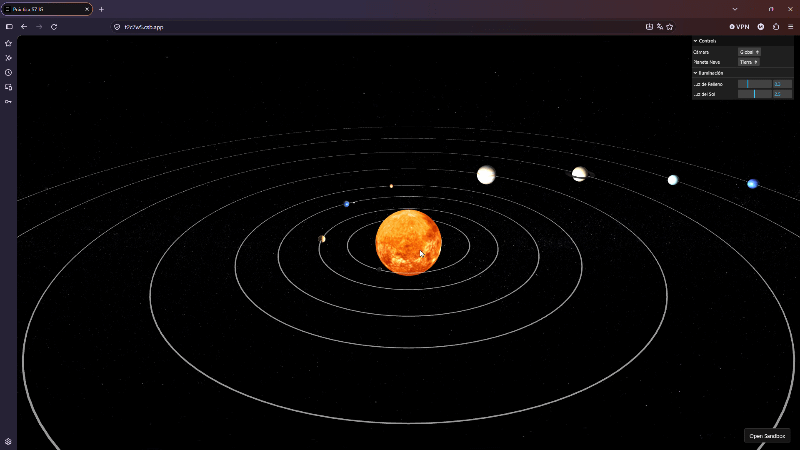
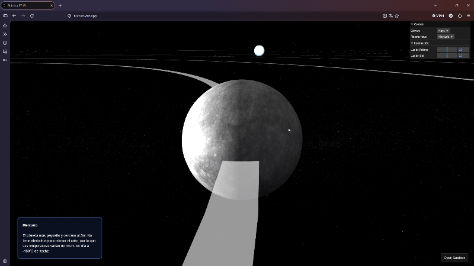

# Autor

Marcos Peña Armario [Github](https://github.com/marcpear)

## Proyecto

[Repositorio de codeSandBox](https://codesandbox.io/p/sandbox/t2c7w5)

[Enlace para la ejecución](https://t2c7w5.csb.app/)

## Descripción del proyecto

Este proyecto es una aplicación web interactiva en 3D que simula un Sistema Solar didáctico, desarrollada utilizando Three.js . La práctica combina gráficos por ordenador, iluminación avanzada y manipulación de cámaras para ofrecer una experiencia de exploración espacial tanto a nivel global como inmersivo.

**Características**

- Se ha empleado el uso de texturas descargadas de [Solar System Scope](https://www.solarsystemscope.com/textures/)

- Sistema de doble cámara: Una vista global del sistema para apreciar todas las órbitas y una vista de "nave" que permite observar de manera más detallada un planeta en específico.

- Panel didáctico: En la vista global, al hacer click en un planeta te muestra la descripción del planeta en cuestión y en la vista de nave, te sale directamente sin necesidad de hacer ninguna acción.

- Cuenta con una interfaz de usuario sencilla que permite alternar los diferentes tipos de cámara, selección el planeta al cual desea "viajar" con la cámara nave y modificar la iluminación de la escena pudiendo configurar la intensidad de luz del sol y el brillo general de la escena

## Controles

- Cámara global: 
		- Rotar (Click izquierdo)
		- Desplazarse por la escena (Mantener click derecho y arrastrar)
		- Zoom (Rueda del ratón) 
		- Selección de planeta para mostrar información (Click izquierdo sobre el cuerpo)
- Vista de Nave:
		- Órbita alrededor del planeta (Clic izquierdo y arrastrar)
		- Zoom orbital (Rueda del ratón)
		

## Ejecución

**Vista Global**

**Vista Nave**

[Video Completo](https://www.youtube.com/watch?v=inhlmakNn5M)

## Uso de IA

En este proyecto se ha empleado la IA de forma de apoyo para la depuración y solución de errores de ejecución, limpieza y optimización del código, mejorar estética en la ejecución del proyecto y recopilación de información didáctica.

Toda implementación e integración al código final ha sido supervisada y adaptada.

**Problemas solucionados con la IA**

Con problemas no me refiero a errores mínimos como por ejemplo errores de sintaxis.

En un principio hubieron problemas con las funciones eventos del ratón ya que no había especificado en un principio que solamente detectase el click o el arrastre de este cuando fuese en el canva, además, tuve problemas con la iluminación en los planetas que contaban con atmósferas haciendo que las sombras de las dichas se viesen muy pixeladas, por último, hubieron altercados con las texturas ya que no eran posibles agregarlas al codesandbox así que las añadí al github y las referencié en el código principal mediante un enlace.

## Referencias

Referencias que han servido para la confección de los diversos ejemplos:

- [Documentación Three.js](https://threejs.org)
- [Documentación Three.js Raycaster](https://threejs.org/docs/#Raycaster)
- [Documentación manejo de sombras Three.js](https://threejs.org/docs/#DirectionalLightShadow)
- [GitHub lil-gui](https://github.com/georgealways/lil-gui)
- [Three.js Textures](https://r105.threejsfundamentals.org/threejs/lessons/threejs-textures.html)

### Librerías usadas

[Three.js](https://threejs.org/) 
[lil-gui](https://lil-gui.georgealways.com/)

