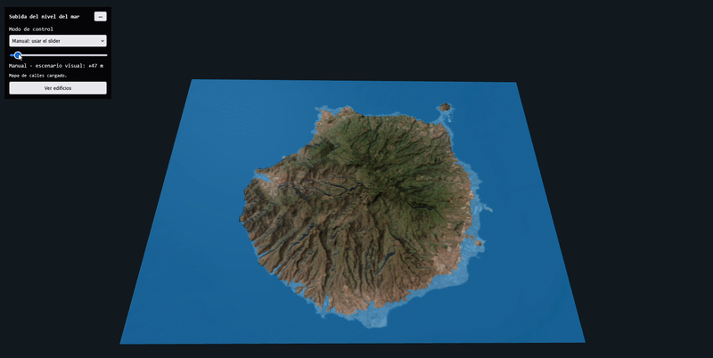
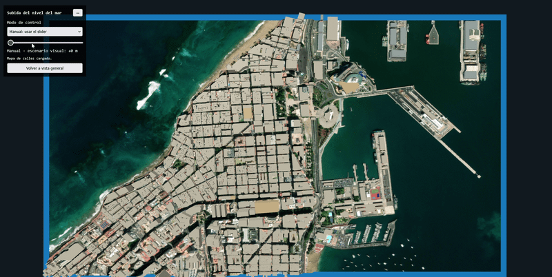

# Autor

Marcos Peña Armario [GitHub](https://github.com/marcpear)

## Proyecto

[Repositorio de CodeSandbox](https://codesandbox.io/p/sandbox/throbbing-worker-tqz82h)

Los archivos se cargan directamente desde el Github, es por eso que no se encuentran en el repositorio de CodeSandbox

[Repositorio con los recursos del proyecto](https://github.com/marcpear/IG_Practicas/tree/main/S8)

[Enlace para la ejecución](https://tqz82h.csb.app/)

## Descripción del proyecto

Este proyecto es una aplicación web interactiva en 3D que representa el relieve de Gran Canaria y permite visualizar escenarios de subida del nivel del mar. Está desarrollada con Three.js y combina un mapa de alturas, texturas cartográficas y edificios de OpenStreetMap.

**Características**

- Terreno de Gran Canaria creado a partir de un heightmap y una textura de la isla.
- Vista detallada de una zona urbana con una textura de calles y edificios extruidos a partir de datos OSM.
- Agua representada como un volumen rectangular semitransparente.
- Control manual del nivel del agua mediante un slider y modo automático animado.
- La subida máxima es de 1000 m en la vista general y de 100 m en la vista de edificios.
- Botón para alternar entre la vista general y la vista de edificios, con un menú que se puede contraer.

Los niveles y alturas se muestran como una visualización didáctica. El proyecto no calcula una inundación física ni constituye una predicción científica.

## Relieve, texturas y datos

### Relieve de Gran Canaria

El relieve procede del modelo Copernicus GLO-30 (COP30), descargado como teselas GeoTIFF desde [GlobalDEM Portal](https://globaldemportal.github.io/). Se utilizaron las teselas `Copernicus_DSM_10_N27_00_W016_00_DEM.tif` y `Copernicus_DSM_10_N28_00_W016_00_DEM.tif`, que cubren la zona de Gran Canaria.

Las teselas se combinaron en QGIS con la herramienta de combinación. Después se mostró el resultado en escala de grises y se exportó como `heightmap.png`, usando la extensión de la isla. Three.js lee los valores de gris de esta imagen para elevar los vértices del terreno.

### Texturas de color

- **`mapa_color2.png`:** textura de la isla completa, preparada y exportada desde QGIS para la vista general. Aporta el color visual del terreno; el relieve lo determina `heightmap.png`.
- **`mapa_calle.png`:** recorte detallado de la zona urbana exportado desde QGIS. Se usa al cambiar a la vista de edificios. Su extensión corresponde a oeste `-15.44362`, este `-15.41905`, sur `28.13138` y norte `28.14508`.
- **`edificios.osm`:** datos de OpenStreetMap con las huellas de los edificios. El programa las convierte en formas extruidas y las coloca sobre el terreno.

CodeSandbox los carga desde GitHub mediante sus enlaces directos.

## Controles

- **Modo de control:** selecciona la subida manual o automática.
- **Slider:** cambia el nivel del agua cuando está seleccionado el modo manual.
- **Ver edificios / Volver a vista general:** alterna entre las dos vistas.
- **Botón − / +:** contrae o expande el menú.
- **Cámara:** arrastra con el botón izquierdo para orbitar y usa la rueda del ratón para acercar o alejar.

En la vista de edificios, el zoom está limitado para mantener la zona urbana dentro de la pantalla.

## Ejecución

**Vista general:**

**Vista edificios**

## Uso de IA

La IA se utilizó como apoyo durante el desarrollo para adaptar ejemplos de Three.js, integrar las texturas y los edificios, y resolver errores de ejecución. También ayudó a documentar las funciones principales del código. La integración y los cambios se revisaron durante el trabajo en CodeSandbox.

## Referencias

- [Three.js](https://threejs.org/)
- [Documentación de Three.js](https://threejs.org/docs/)
- [OrbitControls](https://threejs.org/docs/#examples/en/controls/OrbitControls)
- [OpenStreetMap](https://www.openstreetmap.org/)
- [QGIS Documentation](https://docs.qgis.org/)
- [Recursos del proyecto en GitHub](https://github.com/marcpear/IG_Practicas/tree/main/S8)

### Librerías usadas

- [Three.js](https://threejs.org/)
- OrbitControls, incluido en los ejemplos de Three.js
